  

  
  
  
  
  
  
  
  
  
  

---

### Open-Source Contributions

- **[QuantDinger](https://github.com/OpenByteInc/QuantDinger)** &nbsp;`Systematic Trading OS`  
  [`#307 (Merged)`](https://github.com/OpenByteInc/QuantDinger/pull/307) Benchmark analytics ($M^2$, Dual-Beta, Batting Avg) &bull; [`#306 (Merged)`](https://github.com/OpenByteInc/QuantDinger/pull/306) Downside risk framework (Sortino, Calmar, Drawdown) &bull; [`#303 (Merged)`](https://github.com/OpenByteInc/QuantDinger/pull/303) Jensen's Alpha & Treynor pipeline

- **[FinancePy](https://github.com/domokane/FinancePy)** &nbsp;`Derivatives Valuation & Risk`  
  [`#420 (Merged)`](https://github.com/domokane/FinancePy/pull/420) Shifted Black–Karasinski (negative rate lattice) &bull; [`#408 (Merged)`](https://github.com/domokane/FinancePy/pull/408) Vectorized CDSCurve discount factors &bull; [`#404 (Merged)`](https://github.com/domokane/FinancePy/pull/404) Cliquet option valuation (Monte Carlo)

---

### Research & Technical Notes

- **[Decomposing OLS Linear Regression into WMA/SMA for 100x Speedup in Polars](https://github.com/huuan26/polars-anta)** &mdash; `Oct 2026`  
  *Closed-form mathematical refactoring of rolling least-squares into prefix sums and weighted moving averages.*

- **[Lowdin Symmetric Orthogonalization for Cross-Sectional Alpha Factors](https://github.com/huuan26/OrthoQuant)** &mdash; `Sep 2026`  
  *Eliminating factor multi-collinearity via SVD-based unitary transformation while preserving maximal correlation.*

- **[Shifted Short-Rate Lattices (BK / BDT) in Negative Yield Regimes](https://github.com/domokane/FinancePy/pull/420)** &mdash; `Oct 2026`  
  *Extending log-normal short rate tree dynamics (Black–Karasinski & Black–Derman–Toy) to negative interest rates with state-price calibration.*
