<!-- GitHub Profile README -->

  

  <i>Bridging rigorous numerical mathematics with systematic quantitative trading and deep learning.</i>

---

## Open-Source Contributions

Major contributions to open-source quantitative finance and algorithmic trading ecosystems:

### [FinancePy](https://github.com/domokane/FinancePy)
*Python library for valuation and risk management of financial derivatives.*  
- **CDSCurve Vectorization & Day Count Alignment** : Aligned day-count convention handling in `CDSCurve.df` with underlying discount curves (fixing hardcoded ACT/365 bypass), implemented seamless vectorization for `Date` lists across discount factors and survival probabilities (`times_from_dates`), and re-enabled comprehensive regression suites.
- **Shifted Black–Derman–Toy Model** : Extended BDT short-rate tree dynamics to support negative interest rates and updated lattice-based derivative pricing under negative yield environments.
- **Equity Cliquet Option Valuation** : Implemented closed-form analytical pricing formulas and Monte Carlo simulation for return cliquet options with local and global caps/floors, validated with regression unit tests.
- *Tech Stack*: Python, Quantitative Finance, Analytical Pricing, Monte Carlo, Short-Rate Trees, Credit Default Swaps (CDS)

### [QuantDinger](https://github.com/OpenByteInc/QuantDinger)
*Open-source quantitative trading and strategy research platform.*  
- **Multi-Timeframe Duration & Metric Annualization** : Aligned monthly timeframe duration (2,592,000 s), annualization scaling factors ($N = 12.0$ for Sharpe, Sortino, volatility), and driving frequency hierarchy across Strategy API V2, validated with comprehensive test suites.
- **Factor Warmup Alignment** : Standardized lookback warmup requirements across technical indicators (EMA, HMA, TEMA, etc.) with parameter-aware dynamic resolution and unit tests to ensure reliable backtesting data feeds and factor evaluation.
- *Tech Stack*: Python, Quantitative Backtesting, Strategy API V2, Alpha Factors, Technical Indicators, Pytest

---

## Featured Personal Projects

### [OrthoQuant](https://github.com/huuan26/OrthoQuant)
*Symmetric factor orthogonalization and cross-sectional risk neutralization framework.*  
- Implemented Löwdin symmetric orthogonalization using SVD to eliminate cross-factor collinearity while minimizing signal distortion.
- Formulated Frisch–Waugh–Lovell QR projection for dynamic sector and market risk exposure stripping.
- Developed collinearity diagnostics (VIF, condition number, ENF) and cross-sectional Rank IC evaluation.
- *Tech Stack*: Python, Numerical Linear Algebra, Matrix Factorization, SVD, QR Decomposition, Pytest

### [ANN-ODE-Solver](https://github.com/huuan26/ANN-ODE-Solver)
*Neural network-based differential equation solver in PyTorch.*  
- Built neural network architectures to solve linear, non-linear, and coupled ODE systems based on the Lagaris et al. framework.
- Formulated trial solutions that analytically satisfy initial and boundary conditions.
- Utilized PyTorch automatic differentiation (`autograd`) for gradient computation and optimization.
- *Tech Stack*: Python, PyTorch, NumPy, Numerical Analysis

---
